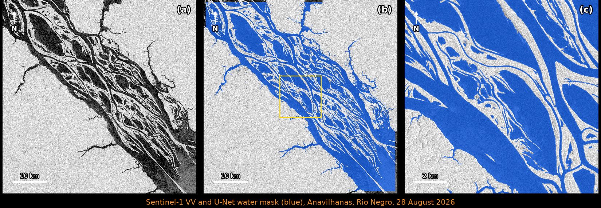

# Sentinel-1 water U-Net

[](https://github.com/fabien-w/sentinel1-water-unet/actions/workflows/ci.yml)
[](https://colab.research.google.com/github/fabien-w/sentinel1-water-unet/blob/main/notebooks/water_sentinel1_colab.ipynb)
[](https://huggingface.co/Fabien-Ctrees/sentinel1-water-unet)
[](https://doi.org/10.3390/rs16061056)
[](LICENSE)

Surface water mapping from **Sentinel-1 SAR** images (10 m, VV + VH) with the U-Net model of
[Wagner et al. (2024), *The Amazon's 2023 Drought: Sentinel-1 Reveals Extreme Rio Negro River Contraction*, Remote Sensing 16(6):1056](https://doi.org/10.3390/rs16061056).

This repository is the open-source release of the model: a PyTorch port of the original R/Keras model
with validated weights, the Python-only SNAP preprocessing of the paper, the prediction and
post-processing workflow, and two end-to-end notebooks (Google Colab and JupyterLab).



*(a) Sentinel-1D VV backscatter over the Anavilhanas archipelago (Rio Negro, Brazil), 28 August 2026;
(b) water predicted by the U-Net (blue); (c) zoom on the yellow box. 55 × 55 km processed in 55 s on one GPU.*

## Contents

- [Overview](#overview)
- [Quickstart](#quickstart)
- [Installation](#installation)
- [Model](#model)
- [Workflow details](#workflow-details)
- [Validation](#validation)
- [Limitations](#limitations)
- [Citation](#citation)
- [Credits](#credits)

## Overview

| | |
|---|---|
| Input | Sentinel-1 IW GRDH, dual polarisation VV + VH, preprocessed with ESA SNAP (σ⁰ in dB, scaled to 8 bits, WGS84, 10 m) |
| Output | water mask: 0 = not water, 1 = water, 255 = no data (Cloud Optimized GeoTIFF) |
| Model | U-Net (34.6 M parameters), trained in the Amazon on 59,387 Sentinel-1 patches with high-resolution reference water masks |
| Accuracy | F1 = 0.93 (precision 0.934, recall 0.926) on 6,057 validation patches (paper, Table 2) |
| Weights | [huggingface.co/Fabien-Ctrees/sentinel1-water-unet](https://huggingface.co/Fabien-Ctrees/sentinel1-water-unet) (CC BY 4.0) |

The workflow, as in the paper:

1. **search** Sentinel-1 scenes over a point (ASF catalogue) and **download** them from the
   `s3://sentinel-s1-l1c` bucket (AWS Open Data, requester pays);
2. **preprocess** with ESA SNAP through its Python API `esa_snappy`;
3. **predict** with the U-Net on 4224 × 4224 tiles (GPU, CPU fallback);
4. **post-process**: scene-border mask (optional SRTM mountain-shade mask);
5. **export** a GeoTIFF and display the result on a map.

## Quickstart

### Google Colab (no installation)

Click the **Open in Colab** badge, choose *Runtime → Change runtime type → T4 GPU*, and run all cells.

- **Without an AWS account** the notebook uses a preprocessed scene of Anavilhanas (28 August 2026)
  hosted on Hugging Face, and runs prediction, post-processing and display.
- **With an AWS account** (to process any scene, any place): add `AWS_ACCESS_KEY_ID` and
  `AWS_SECRET_ACCESS_KEY` in the Colab **Secrets** panel. The notebook installs SNAP (~5 min),
  downloads the scene (~US$0.12 of data transfer, see [Data access and costs](#data-access-and-costs))
  and preprocesses it.

**Choosing another date**: in step b, type `START` and `END` as `YYYY-MM-DD`, or just `YYYY-MM` for a whole
month. A day that does not exist (e.g. `2026-06-31`) is corrected to the last day of the month.

### JupyterLab (local computer or cloud machine)

```bash
git clone https://github.com/fabien-w/sentinel1-water-unet.git
cd sentinel1-water-unet
conda env create -f environment.yml && conda activate s1water
pip install -e ".[notebook]"
# SNAP + esa_snappy: see docs/INSTALL_SNAP.md
cp .env.example .env      # then set AWS_PROFILE or your AWS keys (the file is git-ignored)
jupyter lab notebooks/water_sentinel1_jupyterlab.ipynb
```

### Command line

```bash
s1water search --lat -2.70 --lon -60.80 --start 2026-08-01 --end 2026-08-31
s1water run --lat -2.70 --lon -60.80 --start 2026-08-01 --end 2026-08-31 --out data/
s1water predict data/<scene>_VV_VH_8bits.tif data/<scene>_water.tif
```

### Python

```python
from s1water.pipeline import predict_scene
predict_scene("scene_VV_VH_8bits.tif", "scene_water.tif")   # weights downloaded from Hugging Face
```

## Installation

Python ≥ 3.10.

| Use | Command |
|---|---|
| prediction only (PyTorch, rasterio) | `pip install "s1water @ git+https://github.com/fabien-w/sentinel1-water-unet.git"` |
| + search and download | `pip install "s1water[data] @ git+..."` |
| notebooks | `pip install -e ".[notebook]"` from a clone |
| exact environment | `conda env create -f environment.yml` (pinned versions, tested) or `pip install -r requirements.txt` |
| SNAP preprocessing | ESA SNAP 14 + `esa-snappy`, see [docs/INSTALL_SNAP.md](docs/INSTALL_SNAP.md) |

GPU: any CUDA GPU with ≥ 12 GB of memory (a 4224 × 4224 tile uses 9.7 GB in float16, e.g. Colab T4,
RTX 3060 12 GB). Without a GPU the code runs on CPU with a warning (~45 s per tile with 4 cores, float32).

### Data access and costs

The Sentinel-1 scenes come from `s3://sentinel-s1-l1c` ([AWS Open Data](https://registry.opendata.aws/sentinel-1/), eu-central-1),
the same source as the paper. This bucket is **requester pays**: an AWS account is required and the
account pays the data transfer, about US$0.09 per GB to the internet (~US$0.12 per scene of 1.3 GB),
free inside AWS eu-central-1. Credentials are read from environment variables, `AWS_PROFILE`, a
git-ignored `.env` file, or Colab secrets. They are never stored by the code.

## Model

U-Net (Ronneberger et al., 2015) as implemented in the paper:

- 4-band input **VV, VH, VV, VH** (the 2-band 8-bit image repeated twice, as in the
  original code), values = 8-bit / 255;
- encoder 32-64-128-256-512 filters, 2 × [conv 3×3 - batch norm - ReLU] per level, max pooling and
  dropout 0.5; centre 1024 filters;
- decoder with nearest upsampling, skip connections and 3 × [conv 3×3 - batch norm - ReLU] per level;
- 1 × 1 convolution + sigmoid; water = probability ≥ 0.5;
- trained with Adam (lr 1e-4), binary cross-entropy + Dice loss, 256 × 256 patches, random flips.

The original model was trained in R (keras/TensorFlow 2.10). The weights were converted to PyTorch
with [`scripts/convert_keras_to_pytorch.py`](scripts/convert_keras_to_pytorch.py) and validated
(see [Validation](#validation)).

## Workflow details

**Preprocessing (ESA SNAP, `s1water.preprocess`)**, identical to the paper:
Apply-Orbit-File (Sentinel precise orbits, polynomial degree 3) → Remove-GRD-Border-Noise →
ThermalNoiseRemoval → Calibration to σ⁰ → Terrain-Correction (GETASSE30 DEM, bilinear, WGS84, 10 m) →
LinearToFromdB → Subset → 8 bits: `(max(-49, min(1, dB)) + 50) × 5`. For bit-exact reproduction of the
paper with SNAP 9, use the graph [`snap_graphs/s1_water_preprocessing.xml`](snap_graphs/s1_water_preprocessing.xml) with `gpt`.

**Prediction (`s1water.predict`)**: the image is padded to a multiple of 4096 px plus 128 px, cut into
4224 × 4224 tiles every 4096 px, and the model crops 64 px on each side, so the 4096 × 4096
predictions join without seams. float16 on GPU, like the original mixed-precision prediction (9.7 GB of GPU memory per tile).

**Post-processing (`s1water.postprocess`)**: the area outside the acquisition footprint and the noisy
scene borders are set to no data (1000 m on the range sides, 500 m on the azimuth sides), as in the
paper. Inside the scene no pixel is masked: 255 in the output means no data only. Optionally
(`apply_shade_mask=True`, `--shade-mask`, or `APPLY_SHADE_MASK` in the notebooks) mountain shadows are
removed with SRTM (slope ≥ 20° on 90 m SRTM, convex hulls). It is off by default because over flat
forest SRTM is noisy and the rule hides lakes and channels, which the paper removed by hand.

## Validation

| Check | Result |
|---|---|
| PyTorch vs Keras (float32), 300 validation tiles | max probability difference 4.8 × 10⁻⁶, masks 100 % identical |
| PyTorch (float16) vs original predictions, 2,379 validation tiles | 99.998 % pixel agreement, same F1 (0.927) |
| Preprocessing with SNAP 9 vs original tiles (98 tiles) | 100 % identical (bit-exact) |
| Preprocessing with SNAP 14 vs original tiles | water masks 99.93 % identical (IoU 0.98) |

## Limitations

- Trained on the Amazon basin (2021-2022 images, Sentinel-1A). Elsewhere (other biomes, arid areas,
  cities) the model has not been evaluated. Since 2025 the scenes come from Sentinel-1C/D; their
  instruments are designed to be identical to Sentinel-1A, and the August 2026 example looks consistent.
- Small rivers of 1-2 pixels (10-20 m) are often missed; flooded forest and flooded shrubs are not
  mapped as open water.
- Strong convective rain cells can raise the backscatter of water and cause omissions. The paper
  corrected them with a 62-date time series and visual inspection; this is not done here.
- Radar shadow in mountains looks like water. The optional SRTM shade mask removes most of it, but the
  manual edits of the paper are not reproduced, so in flat areas it would also hide lakes: keep it off
  there (default).
- Precise orbit files are published ~20 days after acquisition; for more recent scenes restituted
  orbits are used (negligible effect at 10 m).
- Preprocessing with SNAP 14 differs from the paper's SNAP 9 by a sub-pixel shift (~3 m): water masks
  agree on 99.93 % of pixels.

## Citation

If you use this code or the weights, please cite:

```bibtex
@article{wagner2024amazon,
  title   = {The Amazon's 2023 Drought: Sentinel-1 Reveals Extreme Rio Negro River Contraction},
  author  = {Wagner, Fabien H. and Favrichon, Samuel and Dalagnol, Ricardo and Hirye, Mayumi C. M. and Mullissa, Adugna and Saatchi, Sassan},
  journal = {Remote Sensing},
  volume  = {16},
  number  = {6},
  pages   = {1056},
  year    = {2024},
  doi     = {10.3390/rs16061056}
}
```

The water occurrence and recurrence maps of the Rio Negro (2022-2023) produced in the paper are
available at <https://doi.org/10.5281/zenodo.10552959>.

## Credits

- **U-Net**: Ronneberger, O., Fischer, P., Brox, T. (2015). U-Net: Convolutional Networks for Biomedical
  Image Segmentation. MICCAI. The original R code was adapted from the RStudio AI blog post
  *Image segmentation with U-Net* (Falbel, 2019, <https://blogs.rstudio.com/ai/posts/2019-08-23-unet/>).
- **SNAP processing**: ESA Sentinel Application Platform (SNAP) and the tutorial *Performing SAR
  processing in Python using snappy* (ESA STEP); the original notebooks were also inspired by
  <https://github.com/wajuqi/Sentinel-1-preprocessing-using-Snappy>.
- **Sentinel-1 data**: contains modified Copernicus Sentinel data (2023, 2026), accessed through the AWS
  Registry of Open Data (`sentinel-s1-l1c`) and searched with the ASF catalogue (`asf_search`).
- **Elevation**: GETASSE30 (terrain correction, via SNAP) and SRTM 1 arc-second (optional shade mask), served by
  the AWS Terrain Tiles open dataset (Mapzen/Linux Foundation).
- **Loss**: binary cross-entropy + Dice coefficient (Milletari et al., 2016).
- **Basemap in notebooks**: Esri World Imagery.

Developed by Fabien H. Wagner at [CTrees](https://ctrees.org). Code under the MIT license, model weights
under CC BY 4.0.
